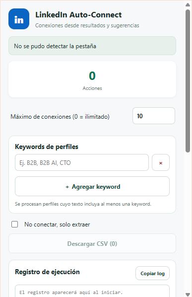

# LinkedIn Auto-Connect Chrome Extension

A Chrome extension for reviewing LinkedIn people-search results and My Network suggestions. Configure profile keywords and a connection or extraction limit in the popup.

> Independent community project. Not affiliated with, endorsed by, or sponsored by LinkedIn.

Developed by [Sebastián Bocek](https://github.com/sebastianbocek).

## How to use

1. Open a LinkedIn **People** search in the tab you want to process. For example: [B2B AI people search](https://www.linkedin.com/search/results/people/?keywords=b2b%20ai&origin=CLUSTER_EXPANSION). The search URL sets the result set; the extension keywords filter the profiles it processes.
2. Open the **LinkedIn Auto-Connect** extension and add the keywords you want to find in profile headlines, titles, and current-position text.
3. Set the maximum number of connections or profiles to extract. Enter `0` for unlimited processing.
4. Leave **No conectar, solo extraer** unchecked to connect with matching profiles and collect them in the CSV. Turn it on to collect profiles without sending invitations.
5. Click **Iniciar**. The extension processes the results and advances to the next page when needed.
6. Click **Descargar CSV** to save the collected profile data.

You can also use the extension on LinkedIn **My Network → Grow** suggestions.

## Download and install

[⬇ **Download the extension (ZIP)**](https://github.com/sebastianbocek/linkedin-auto-connect-chrome-extension/archive/refs/heads/main.zip)

1. Download and extract the ZIP file.
2. Open `chrome://extensions/` in Chrome and turn on **Developer mode**.
3. Click **Load unpacked** and select the extracted folder containing `manifest.json`.

## Preview

## Features

- Add and remove profile keywords in the popup. Matching is case-insensitive and accepts a keyword within a longer phrase, such as `B2B` in `B2B Outbound`.
- Checks the profile headline, title, and current-position text in each result card.
- Clicks **Connect** only. Profiles marked **Pending**, **Follow**, or **Message** are logged and skipped.
- If LinkedIn asks whether to add a note, selects **Send without a note** and continues.
- Scrolls through people-search results and advances to the next page when the current results are exhausted.
- Matching profile names, categories, locations, and LinkedIn links are collected for CSV export by default.
- The **No conectar, solo extraer** mode does not send connection invitations and counts extracted profiles toward the configured limit.
- View and copy the activity log from the popup.
- Stops when LinkedIn displays its weekly connection invitation limit.

## Privacy and permissions

The extension uses `activeTab` and `scripting` to interact with the LinkedIn tab after you start it, and `storage` to remember your popup settings. Matching profile data is collected from LinkedIn result cards and downloaded locally when you request the CSV; the extension does not upload it to a server.

## Important

This tool automates actions on LinkedIn. Review your configuration and use it thoughtfully. LinkedIn may change its interface, which can affect how profile cards and controls are detected.

## Español

### Cómo usar

1. Abre en la pestaña de Chrome una búsqueda de personas de LinkedIn. Por ejemplo: [búsqueda de personas B2B AI](https://www.linkedin.com/search/results/people/?keywords=b2b%20ai&origin=CLUSTER_EXPANSION). La URL determina los resultados; las keywords de la extensión filtran los perfiles que procesará.
2. Abre la extensión **LinkedIn Auto-Connect** y agrega las keywords que quieras buscar en los titulares, cargos y puestos actuales de los perfiles.
3. Define el máximo de conexiones o perfiles para extraer. Escribe `0` para continuar sin límite.
4. Deja desmarcada **No conectar, solo extraer** para conectar con perfiles coincidentes y recopilar sus datos en el CSV. Actívala para extraer perfiles sin enviar invitaciones.
5. Pulsa **Iniciar**. La extensión procesa los resultados y avanza a la página siguiente cuando corresponde.
6. Pulsa **Descargar CSV** para guardar los datos recopilados.

También puedes usar la extensión en las sugerencias de **My Network → Grow** de LinkedIn.

### Instalación

1. [Descarga el ZIP](https://github.com/sebastianbocek/linkedin-auto-connect-chrome-extension/archive/refs/heads/main.zip) y descomprímelo.
2. Abre `chrome://extensions/` y activa el **Modo desarrollador**.
3. Pulsa **Cargar descomprimida** y selecciona la carpeta que contiene `manifest.json`.

### Funciones

- Agrega o quita keywords desde la interfaz. La coincidencia no distingue mayúsculas y acepta una keyword dentro de una frase más larga, por ejemplo `B2B` en `B2B Outbound`.
- Busca en el titular, cargo y puesto actual de cada ficha.
- Pulsa únicamente **Connect**. Registra y omite perfiles con estado **Pending**, **Follow** o **Message**.
- Si LinkedIn pregunta si quieres agregar una nota, pulsa **Send without a note** y continúa.
- Recopila nombre, categoría, ubicación y enlace de los perfiles coincidentes para exportarlos a CSV.
- Muestra un registro de actividad que puedes copiar desde la interfaz.
- Se detiene si LinkedIn muestra el límite semanal de invitaciones.

La extensión usa `activeTab`, `scripting` y `storage`. Los datos del CSV se descargan localmente; no se suben a un servidor.
